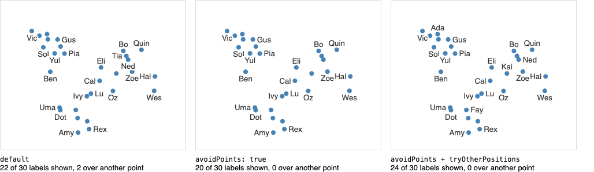

# Smart Labels

Add nearest on-hover and labels when there is space to your D3 chart. It should be faster than force based versions as it uses d3-delaunay, and it will choose which labels to show based on the amount of space available in the chart.

Based on the [voronoi-labels](https://observablehq.com/@d3/voronoi-labels) example by [@mbostock](https://observablehq.com/@mbostock), and combining it with [@fil's](https://observablehq.com/@fil) great [occlusion](https://observablehq.com/@fil/occlusion) example. 

Receives the data, accessors for the x and y coordinates as well as the label. Expects all the coordinates to come in pixels. 

## Usage

```html  
  <script src="https://cdn.jsdelivr.net/npm/smart-labels"></script>
  <script>
    const svg = d3.create("svg")   
    // 𓈓 add your own marks (e.g. points), we will add the text labels
      
    smartLabels(data, {
        target: svg, // where to draw
        label: (d) => d.name, // where to find the label in the data
        x: (d) => xScale(d.x), // expected in pixels
        y: (d) => yScale(d.y),
        labelsInCentroids : true, // Draw the labels in the centroid of the voronoi
        useOcclusion: true // Make occluded labels transparent
    })
  </script>
```

### Default options

```js
{
    x = (d) => d[0], // x coordinate accessor, expected to be in pixels
    y = (d) => d[1], // y coordinate accessor, expected to be in pixels
    r = () => 3, // radius accessor, expected to be in pixels
    label = (d, i) => i, // Accessor for the label
    renderer = "svg", // canvas or svg
    fill = "#333", // label fill color
    stroke = "white", // label stroke color
    width = null,
    height = null,
    target = null, // Where do you want it to draw
    font = "10pt sans-serif", // string or (d, i) => string
    hover = true, // Show label of the hovered point
    onHover = (i) => i, // callback when hovered, will pass the index of the selected element
    hoverFont = "bolder 12pt sans-serif", // string or (d, i) => string
    labelsInCentroids = true,
    threshold = 2000, // Areas over this size would get labels
    alwaysShow = () => false, // If returns true for the node, it will always show the label
    showLabel = (d, cell) => alwaysShow(d) || -d3.polygonArea(cell) > threshold, // If true, show the label
    backgroundFill = "#fefefe01", // What to paint the bg rect of the labels. Needed for the onHover
    strokeWidth = 5,

    showVoronoi = false,
    voronoiStroke = "#ccc",

    showAnchors = false,
    anchorsStroke = "orange",
    anchorsFill = "none",

    useOcclusion = true,
    occludedStyle = "opacity: 0.2", // css style rules to be used on occluded labels
    tryOtherPositions = false, // with occlusion, an occluded label tries the point's other sides
                               // (opposite side first) before being hidden
    avoidPoints = false, // with occlusion, also hide labels that cover another point's circle (x, y, r):
                         // true for every point, or (d, i) => boolean for the points that should block labels

    // For debugging
    showPoints = false,
    pointsFill = "#ccc",
    pointsSelectedFill = "firebrick",
    pointsStroke = "#ccc",
    debug = false,
    selected = null,
    padding = 3, // label padding in pixels
  }
```


## Keeping labels off the points

By default, occlusion only hides labels that overlap other labels, so a label can still be drawn on top of another point. Two options (SVG only, since they need `useOcclusion`) help with that:

- **`avoidPoints`** also hides labels that cover another point's circle, using `x`, `y` and `r`. Pass `true` to check every point, or `(d, i) => boolean` to check only some of them, e.g. the points with images or the ones you care about. A label is never hidden by its own point.
- **`tryOtherPositions`** gives an occluded label another chance: it tries the other sides of its anchor (the opposite side first, then the remaining two) and keeps the first free one. The anchor is the point, or the cell's centroid when `labelsInCentroids` is `true`.

```js
smartLabels(data, {
  target: svg,
  x: (d) => xScale(d.x),
  y: (d) => yScale(d.y),
  r: () => 4, // the radius of your circles, in pixels
  label: (d) => d.name,
  labelsInCentroids: false,
  avoidPoints: true,
  tryOtherPositions: true,
});
```



From [examples/avoid-points.html](examples/avoid-points.html): the same 30 points with `threshold: 0` and occluded labels hidden. `avoidPoints` alone removes the labels that sat on other points; adding `tryOtherPositions` moves labels to a free side instead of hiding them, so more labels are shown than with the default.

## Known problems

* Doesn't guarantee non-overlapping
* If two marks share the same coordinates it will draw their labels and anchors in the same position. It won't be possible to hover over the repeated ones


## More examples

For observable notebooks please see [@john-guerra/smart-labels](https://observablehq.com/@john-guerra/smart-labels#smartLabels)

For other vanilla JS examples see the [/examples](/examples) folder